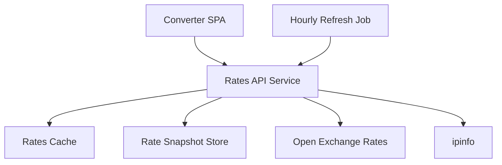
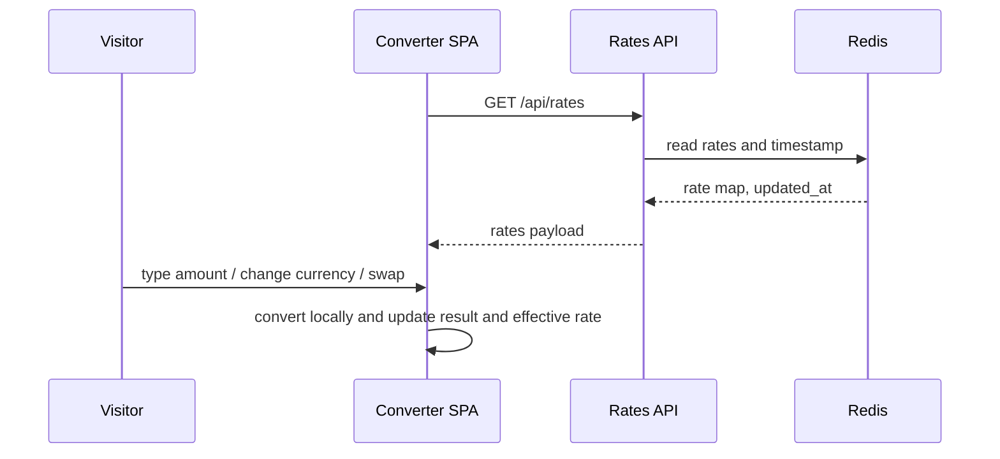
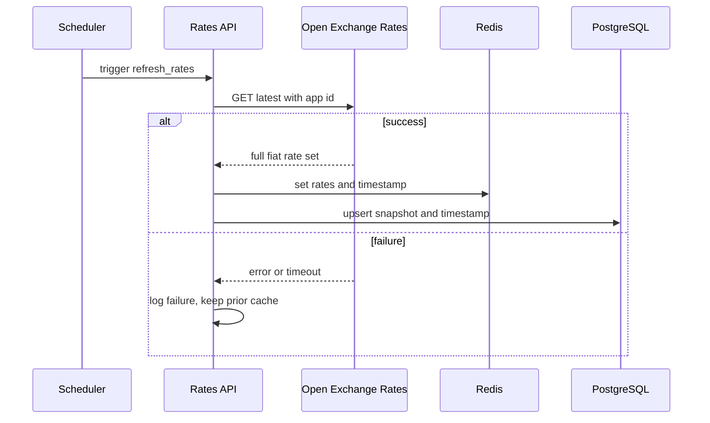
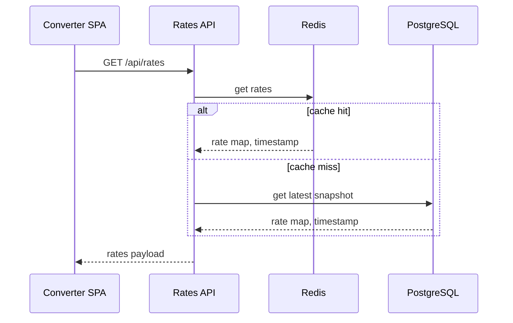
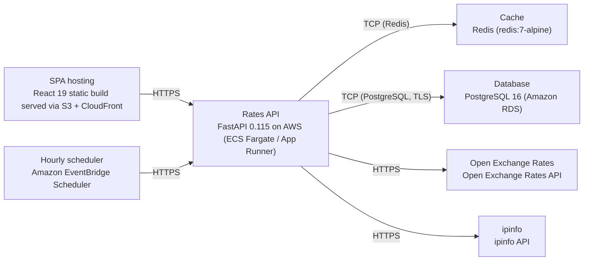

# Architecture

> Maintained by QuorQ AI SDLC. Text between `sdlc:auto` markers is regenerated; anything outside them is yours and is kept.

<!-- sdlc:auto:start narrative -->
## Overview

### ARCH-001 · approved · source: architecture:overview

Overall system is a lightweight public currency converter: a React SPA for instant client-side conversion backed by a FastAPI service that keeps the FX provider key secret, caches rates in Redis, and persists a resilience snapshot in PostgreSQL.

Approved architecture, version 2. Any anonymous visitor enters an amount, picks from/to currencies across all ISO 4217 fiat currencies, can swap them, and instantly sees the converted value, effective rate, and a 'rates last updated' timestamp with an indicative-only notice. Backend refreshes rates hourly on a schedule, caches them in Redis for instant serving, and persists the latest snapshot plus timestamp in PostgreSQL so the tool stays up if the provider is briefly unreachable. Optional IP geolocation (ipinfo) pre-fills the visitor's local currency. Everything runs on AWS.

- ⚠ No mapping provided between this architecture and specific requirement IDs (US-001..US-011); traceability to individual requirements could not be confirmed.

### ARCH-002 · approved · source: architecture:component:frontend

Converter SPA (React 19) is the single interactive screen users interact with: amount entry, currency pickers, swap, and instant results.

Single interactive screen comprising: amount input, searchable from/to currency pickers over ISO 4217 fiats, a swap button, instant client-side conversion using fetched rates, effective-rate display, last-updated timestamp, and an indicative-only notice. Mobile-responsive.

### ARCH-003 · approved · source: architecture:component:backend

Rates API Service (FastAPI 0.115) serves cached rates/currency metadata to the SPA and keeps the FX provider key server-side.

Serves cached rates and currency metadata to the SPA, keeps the FX provider key server-side, exposes an optional geo-default endpoint, and runs the hourly refresh job. Reads from Redis first, falls back to the PostgreSQL snapshot if cache is empty.

### ARCH-004 · approved · source: architecture:component:scheduler

Hourly Refresh Job (FastAPI 0.115, triggered via EventBridge) keeps rate data current.

On an hourly schedule, triggers the backend to fetch the full ISO 4217 rate set from Open Exchange Rates, write it to Redis, and persist the snapshot and timestamp to PostgreSQL. Logs failures and leaves the prior cache in place on error.

### ARCH-005 · approved · source: architecture:component:cache

Rates Cache (Redis 7-alpine) holds the latest rate map in memory for instant serving.

In-memory store of the latest rate map and fetch timestamp, used for instant serving on every visitor conversion, avoiding per-request calls to the FX provider.

### ARCH-006 · approved · source: architecture:component:database

Rate Snapshot Store (PostgreSQL 16) durably persists the latest rate snapshot as a resilience fallback.

Durable store of the latest rate snapshot and last-updated timestamp so a recent value survives a cache flush or provider outage. No user data is stored.

### ARCH-007 · approved · source: architecture:component:fx_provider

Open Exchange Rates is the third-party SaaS supplying the full ISO 4217 fiat rate set.

Called server-side only, using the secret app id, so the key is never exposed to the browser.

### ARCH-008 · approved · source: architecture:component:geolocation

ipinfo is an optional SaaS lookup used to pre-fill the visitor's local currency based on IP-derived country.

Looks up the visitor's country from their IP to optionally pre-fill the from-currency with their local currency. Treated as optional/best-effort within the architecture.

- ⚠ Behavior when ipinfo is unavailable is described at the endpoint level (defaults to USD) but not at the component level; confirm this is the sole fallback behavior.

### ARCH-009 · approved · source: architecture:critical_paths

Three critical paths define system behavior: instant client-side conversion, hourly scheduled refresh, and graceful fallback serving.

1) Instant conversion in the browser: on load the SPA fetches the rate map and metadata once, then recalculates the result and effective rate locally on every amount, currency, or swap change with no further requests. 2) Hourly refresh and cache write: an hourly scheduled job fetches the full fiat rate set from Open Exchange Rates, writes it to Redis, and persists the snapshot and timestamp to PostgreSQL; on failure it logs and keeps the previous cached rates. 3) Graceful serve with fallback: when a visitor requests rates, the backend serves from Redis, and if the cache is empty it reads the last snapshot from PostgreSQL so the tool still shows a recent value.

### ARCH-010 · approved · source: architecture:entities

Single persisted entity, rate_snapshot, captures the latest FX rate data and provenance.

rate_snapshot fields: id, base_currency, rates, fetched_at, source, created_at. This is the only persisted entity; no user data is stored anywhere in the system.

### ARCH-011 · approved · source: architecture:endpoints

Five backend endpoints support the SPA and internal operations: rates, currencies, geo-default, health, and an internal refresh trigger.

GET /api/rates - returns the cached rate map (base plus per-currency rates) and last-updated timestamp for client-side conversion; serves from Redis, falls back to the Postgres snapshot. GET /api/currencies - returns the full ISO 4217 fiat currency list (code and name where available) for the from/to pickers. GET /api/geo-default - optional; resolves the visitor's country from IP via ipinfo and returns a suggested default from-currency, defaulting to USD when unavailable. GET /api/health - liveness and cache-status check for operations. POST /internal/refresh - triggers an immediate rate refresh from Open Exchange Rates; called by the hourly scheduler; not exposed publicly.

### ARCH-012 · approved · source: architecture:deployment

Deployment runs entirely on AWS: static SPA via S3+CloudFront, FastAPI backend on ECS Fargate/App Runner, EventBridge-scheduled refresh, Redis container, and RDS PostgreSQL, plus two external SaaS dependencies.

SPA hosting: React 19 static build served via S3 + CloudFront (static assets/CDN). Rates API: FastAPI 0.115 on AWS ECS Fargate/App Runner, Python 3.12 container. Hourly scheduler: Amazon EventBridge Scheduler (managed cron trigger). Cache: Redis redis:7-alpine (container). Database: PostgreSQL 16 on Amazon RDS (managed Postgres). External SaaS: Open Exchange Rates API and ipinfo API.

### ARCH-013 · approved · source: architecture:tech_decisions

Key technology choices: React 19 frontend, FastAPI 0.115 backend, PostgreSQL 16 database, AWS cloud -- each chosen over named alternatives for fit and cost reasons.

Frontend: React 19 (alternatives considered: Vue, Svelte) -- chosen because the product is one live, no-reload screen (amount box, two pickers, swap, instant result); React 19 handles this reactive recalculation cleanly and produces the required mobile-responsive page. Backend: FastAPI 0.115 (alternatives: Flask, Express) -- chosen because the backend's only job is fetch-cache-serve; FastAPI gives typed endpoints and schedulable refresh in very little code while keeping the OXR key server-side (referenced as NFR-001). Database: PostgreSQL 16 (alternatives: SQLite, DynamoDB) -- chosen because only the latest rate snapshot and timestamp need persisting as a resilience fallback; Postgres 16 stores the rate map as JSONB reliably at no added adoption cost (referenced as NFR-004). Cloud: AWS (alternatives: GCP, Azure) -- chosen as cheap at low traffic, able to absorb occasional spikes, and providing EventBridge Scheduler for the hourly refresh plus managed hosting for the key and backend in one place.

- ⚠ Technology rationale references NFR-001 and NFR-004, but these identifiers are not present in the known requirement key list (US-001..US-011); their source/definition is unconfirmed and should be reconciled with the requirements phase documentation.
<!-- sdlc:auto:end narrative -->

<!-- sdlc:auto:start building-blocks -->
## Building Block View

| ID | Name | Technology | Responsibility | Depends on |
|---|---|---|---|---|
| frontend | Converter SPA | React 19 | Single interactive screen: amount input, searchable from/to currency pickers over ISO 4217 fiats, swap button, instant client-side conversion using fetched rates, effective-rate display, last-updated timestamp, and indicative-only notice. Mobile-responsive. | backend |
| backend | Rates API Service | FastAPI 0.115 | Serves cached rates and currency metadata to the SPA, keeps the FX provider key server-side, exposes an optional geo-default endpoint, and runs the hourly refresh job. Reads from Redis first, falls back to the PostgreSQL snapshot. | cache, database, fx_provider, geolocation |
| scheduler | Hourly Refresh Job | FastAPI 0.115 | On an hourly schedule, triggers the backend to fetch the full ISO 4217 rate set from Open Exchange Rates, write it to Redis, and persist the snapshot and timestamp to PostgreSQL. Logs failures and leaves prior cache in place on error. | backend |
| cache | Rates Cache | Redis (redis:7-alpine) | In-memory store of the latest rate map and fetch timestamp for instant serving on every visitor conversion, avoiding per-request provider calls. | — |
| database | Rate Snapshot Store | PostgreSQL 16 | Durable store of the latest rate snapshot and last-updated timestamp so a recent value survives a cache flush or provider outage. No user data. | — |
| fx_provider | Open Exchange Rates | Open Exchange Rates (SaaS) | Third-party FX API supplying the full set of ISO 4217 fiat rates, called server-side with the secret app id. | — |
| geolocation | ipinfo | ipinfo (SaaS) | Looks up visitor country from IP to optionally pre-fill the from-currency with their local currency. | — |

<!-- sdlc:auto:end building-blocks -->

<!-- sdlc:auto:start runtime -->
## Runtime View

### Instant conversion in the browser

On load the SPA fetches the rate map and metadata once, then recalculates the result and effective rate locally on every amount, currency, or swap change with no further requests.

- **Components:** frontend, backend, cache
- **Modules:** useRates hook, ConverterForm, CurrencySelect, convert util
- **Key functions:** fetchRates(), convert(amount, from, to, rates), effectiveRate(from, to, rates), onSwap()

### Hourly refresh and cache write

An hourly scheduled job fetches the full fiat rate set from Open Exchange Rates, writes it to Redis, and persists the snapshot and timestamp to PostgreSQL. On failure it logs and keeps the previous cached rates.

- **Components:** scheduler, backend, fx_provider, cache, database
- **Modules:** refresh_job, oxr_client, rates_repository, cache_repository
- **Key functions:** refresh_rates(), oxr_client.get_latest(), cache.set_rates(map, ts), snapshot_repo.upsert(map, ts)

### Graceful serve with fallback

When a visitor requests rates, the backend serves from Redis, and if the cache is empty it reads the last snapshot from PostgreSQL so the tool still shows a recent value.

- **Components:** backend, cache, database
- **Modules:** rates_router, cache_repository, rates_repository
- **Key functions:** get_rates(), cache.get_rates(), snapshot_repo.get_latest()

<!-- sdlc:auto:end runtime -->

<!-- sdlc:auto:start deployment-view -->
## Deployment View

| Name | Service | Runtime | Scaling | Environment |
|---|---|---|---|---|
| SPA hosting | React 19 static build served via S3 + CloudFront | Static assets / CDN | CDN edge caching, scales with traffic | dev |
| Rates API | FastAPI 0.115 on AWS (ECS Fargate / App Runner) | Python 3.12 container | 1 task, scale-out on CPU for shared spikes | dev |
| Hourly scheduler | Amazon EventBridge Scheduler | Managed cron trigger | n/a | dev |
| Cache | Redis (redis:7-alpine) | Container | single node, in-memory | dev |
| Database | PostgreSQL 16 (Amazon RDS) | Managed Postgres | single small instance | dev |
| Open Exchange Rates | Open Exchange Rates API | External SaaS | n/a | dev |
| ipinfo | ipinfo API | External SaaS | n/a | dev |

| Source | Target | Protocol |
|---|---|---|
| SPA hosting | Rates API | HTTPS |
| Rates API | Cache | TCP (Redis) |
| Rates API | Database | TCP (PostgreSQL, TLS) |
| Rates API | Open Exchange Rates | HTTPS |
| Rates API | ipinfo | HTTPS |
| Hourly scheduler | Rates API | HTTPS |

<!-- sdlc:auto:end deployment-view -->

<!-- sdlc:auto:start decisions -->
## Architecture Decisions

| Layer | Choice | ADR |
|---|---|---|
| Frontend | React 19 | [ADR-0001](adr/frontend.md) |
| Backend | FastAPI 0.115 | [ADR-0002](adr/backend.md) |
| Database | PostgreSQL 16 | [ADR-0003](adr/database.md) |
| Cloud | AWS | [ADR-0004](adr/cloud.md) |
<!-- sdlc:auto:end decisions -->

<!-- sdlc:auto:start links -->
## Related Documents

- [Data Model](data-model.md)
- [API Specification](api/openapi.yaml)
- [Architecture Decision Records](adr/README.md)
<!-- sdlc:auto:end links -->
