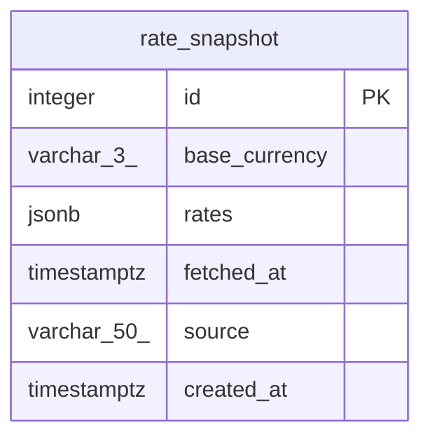

# Data Model

<!-- sdlc:auto:start entities -->
### rate_snapshot

| Field | Type | PK | FK | Nullable |
|---|---|---|---|---|
| id | integer | True | — | False |
| base_currency | varchar(3) | False | — | False |
| rates | jsonb | False | — | False |
| fetched_at | timestamptz | False | — | False |
| source | varchar(50) | False | — | False |
| created_at | timestamptz | False | — | False |
<!-- sdlc:auto:end entities -->

<!-- sdlc:auto:start relationships -->
_No relationships recorded._
<!-- sdlc:auto:end relationships -->

<!-- sdlc:auto:start er-diagram -->

<!-- sdlc:auto:end er-diagram -->
