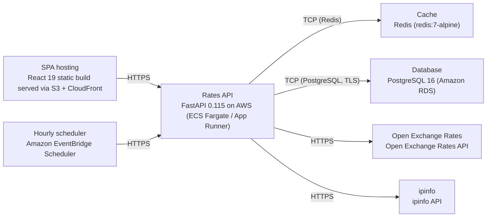

# Deployment Guide

> Maintained by QuorQ AI SDLC. Text between `sdlc:auto` markers is regenerated; anything outside them is yours and is kept.

<!-- sdlc:auto:start how-it-deploys -->
Pushes to `main` run `.github/workflows/deploy.yml`, which builds the API image (if there is a backend) and deploys the SPA to AWS Amplify. Commits touching only `docs/sdlc/**` don't deploy. Deployments can also be started from the platform's Deployment tab.
<!-- sdlc:auto:end how-it-deploys -->

<!-- sdlc:auto:start environments -->
| Name | Service | Runtime | Scaling | Environment |
|---|---|---|---|---|
| SPA hosting | React 19 static build served via S3 + CloudFront | Static assets / CDN | CDN edge caching, scales with traffic | dev |
| Rates API | FastAPI 0.115 on AWS (ECS Fargate / App Runner) | Python 3.12 container | 1 task, scale-out on CPU for shared spikes | dev |
| Hourly scheduler | Amazon EventBridge Scheduler | Managed cron trigger | n/a | dev |
| Cache | Redis (redis:7-alpine) | Container | single node, in-memory | dev |
| Database | PostgreSQL 16 (Amazon RDS) | Managed Postgres | single small instance | dev |
| Open Exchange Rates | Open Exchange Rates API | External SaaS | n/a | dev |
| ipinfo | ipinfo API | External SaaS | n/a | dev |
<!-- sdlc:auto:end environments -->

<!-- sdlc:auto:start live -->
_Not deployed yet._
<!-- sdlc:auto:end live -->

<!-- sdlc:auto:start topology -->

<!-- sdlc:auto:end topology -->
